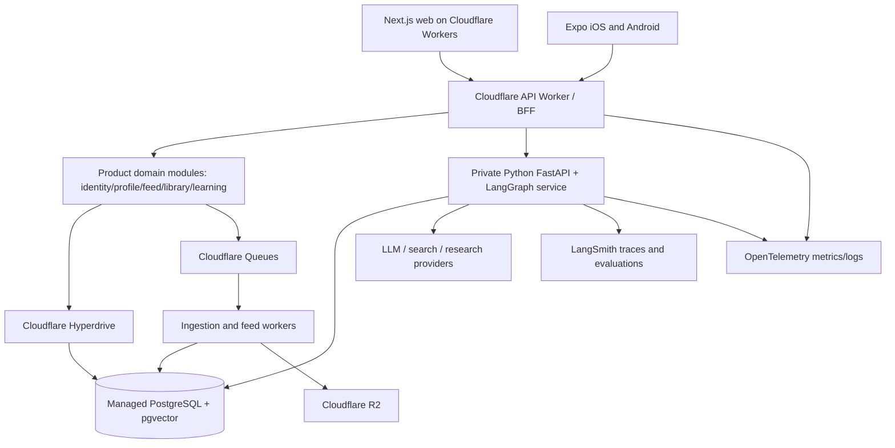

# 04 — System Architecture, Trust Boundaries and Scaling Path

## Architecture style

**Client state lesson (10 November 2026):** the Neon client is a callable Proxy.
When storing it in React state after the browser-only import, use a value-returning
updater (`setClient(() => authClient)`). Passing it directly invokes an unintended
root auth request. A real SDK/React regression probe verifies zero requests during
storage. This client-loading check complements SSR and server handler tests.

**Managed Auth implementation lesson (9 November 2026):** Neon SDK server
handlers passed the vinext compatibility spike, but its browser SDK 0.8.2
generates a random tab ID at module evaluation. Importing it during Worker SSR
caused 500 responses despite a successful build. Load that browser client after
hydration, retaining the server-rendered Profile shell. Final built-Worker
Miniflare checks pass 13/13. SDK mock tests alone are insufficient evidence of
Worker compatibility or Google sign-in. The web now uses managed Auth; the owner
confirmed Google sign-in on 10 November. The API now independently validates the
opaque managed session token against the configured branch's get-session endpoint,
without cached browser claims. A configured workerd test with mocked Neon covers
two users and revocation; the live protected-API browser check remains open. Product SQL
continues through Hyperdrive; managed Auth owns its own auth schema.

**Modular product backend + separately deployable agent backend, with asynchronous ingestion.** Avoid microservices prematurely. Keep frontend independent of LLM providers. APIs are owned by bounded contexts, not by individual screens.

**Placement:** Next.js App Router via Cloudflare Workers (spike vinext beta/OpenNext fallback). API Worker (Hono or minimal native Worker) handles auth/routing/product-domain reads and safe writes; Python FastAPI container handles LangGraph and RAG/tool-intensive AI; both reach managed Postgres via distinct tested connections. Cloudflare R2 for approved uploads/scene bundles, Queues for asynchronous workloads, scheduled triggers for opt-in discovery jobs. LangSmith for AI traces and evals; OpenTelemetry for whole-system correlations.

## Mandatory trust boundaries
Browser/mobile → gateway: OIDC/JWT/session validation, rate limits, request validation. Gateway → agent: private/protected origin and service identity; propagate user-scoped authenticated claims (never trust client-supplied user_id); Python revalidates entitlement and tenant for reads. Product/agent → DB: least-privileged users, segregated schemas or grants, parameterized statements, tenant filters; adversarial cross-user tests. Queues → consumers: signed payload/known schema, idempotency keys, retry budgets, DLQ.

## Ownership and responsibility
- Edge web: presentation, caching of public safe assets, authenticated SSR/BFF patterns; not source of truth.
- Product API: accounts/profile/topic prefs, recommendation serving, save/dismiss, library, learning and scenes metadata, consent state. No LLM per scroll.
- Agent API: retrieval/tools, memory-aware graph state, LLM service adapter, cancellation/budget; not source of truth for user profiles.
- Async workers: provider sync, enrichment, embeddings, candidate generation, feed refresh and data retention.
- DB: authoritative schema, relationships, transaction boundaries. PostgreSQL is the source of truth, not KV.

## Important data flows
**Feed read:** authorized `/v1/feed?cursor=...` → check profile/version → pull pre-ranked items or compute a cheap ranking from cached candidates → hydrate source metadata → exclude muted/dismissed/recently seen → signed next cursor → return response. No new provider API queries nor LLM inference in feed request path.

**Agent turn:** verified user + thread ID → load typed/checkpoint state → retrieve only authorized memory/source candidates → plan bound tool calls with budgets → validate source IDs/citations → stream progress/content with sequence and request ID → persist turn and provenance → trace redacted spans.

**Content ingest:** provider/manual ingestion request → transactional `ingest_jobs` + outbox event → queue publishing worker → consumer pulls source metadata/allowed content → canonicalize/dedupe → classify/tag/embed depending rights → update catalog/recommendation candidates → acknowledgement. Work must be idempotent.

## Failure behavior
Provider down: serve last valid catalog with stale badge; queue backlog alarm. Agent down: feed still works; research shows retryable status. DB degraded: cached non-sensitive public discovery only; no fake success of writes. LangSmith unavailable: do not fail user requests; buffer/drop traces per privacy policy. Worker retries: exactly-once **effects**, not exactly-once delivery, via DB constraints/idempotency.

## Scaling triggers and constraints
Early growth: scale independent Python workers by agent concurrency (not feed QPS); optimize DB connections and traces; instrument feed cache hit and p95 latency. Larger demand: replicas, dedicated vector indexing, asynchronous rerank worker, Redis if measurements prove need. Don't introduce Kafka, Neo4j, separate graph DB, multi-region active/active, or autonomous multi-agent mesh without ADR plus comparative benchmarks.

## Compatibility spikes (before irreversible decisions)
Verify vinext with auth, API streaming, SSR, deployed images and R2 binding; OpenNext fallback. Verify Expo real device network/secure storage, EAS compatibility. Verify auth provider cross-runtime JWT/JWKS. Verify provider data access, pricing and permitted persistence. Record measurements and choice in ADR.

## Managed Auth development branching — verified provisioning recovery, 9 November 2026

The owner confirms this Neon project contains setup/test data only. Managed
Better Auth was already configured on production/neondb. A normal full child
branch, dev-auth-working (`br-noisy-poetry-zaka8dav`), created at
2026-11-09T09:41:40Z inherited managed Auth successfully: owner CLI status shows
better_auth, database neondb, and a distinct Auth/JWKS endpoint on
`ep-muddy-lab-za9hvwfl`. This is provider configuration evidence, not app login,
Google callback, session persistence or release acceptance.

Use normal branching from an Auth-configured source when the source data is
appropriate for development. Auth configuration is stored alongside Auth data;
schema-only copying is not an equivalent way to reproduce that environment.
The earlier schema-only rehearsal retained neon_auth structure but was
unconfigured; enabling against a separate database then returned HTTP 412.
The failing internal role/SQL operation remains unknown. A temporary CREATE
grant did not fix it and was revoked. No service-role privilege workaround is
part of the architecture. Preserve the failed branch for diagnosis.

Managed Auth owns authentication storage and its HTTPS service. Cloudflare
continues hosting the web/product API; product SQL uses Hyperdrive to Neon,
with pgvector remaining the semantic-index target. The current code still uses
self-hosted Better Auth. Replacing that boundary requires a verified Neon SDK
integration, explicit branch-bound session/token validation at the product API,
and logout/profile/failure-path tests. Do not run self-hosted migrations against
the managed neon_auth schema or assume provider status proves those tests.

Sources: [Auth branching](https://neon.com/docs/auth/branching-authentication),
[schema-only branches](https://neon.com/docs/guides/branching-schema-only).
Decision and evidence: docs/22 and docs/24; current setup: docs/39.

## Development SQL role separation — confirmed setup lesson, 10 November 2026

Migration 0001 is applied on dev-auth-working and its checksum matches. Owner
verification now explicitly reports ROLE_BYPASSES_RLS for neondb_owner. FORCE
RLS does not constrain a BYPASSRLS role. Using migration credentials for runtime
and isolation proof was a setup-script error, not evidence that the policy SQL
is broken. Preserve the migration and the owner's administrative privileges.

The prepared repair uses a SQL-created polymatik_app login with NOBYPASSRLS and
no elevated memberships. Migrations retain the owner connection; verification
and the local Hyperdrive launcher use the restricted login. The role gets only
CONNECT, product-schema USAGE, catalog SELECT and RLS-controlled SELECT/INSERT
on the two private foundation tables. No managed Auth grants or default
privileges are added. Neon Console/CLI-created roles inherit neon_superuser,
so they are not the role-creation path for this purpose. Role provisioning is
an explicit privileged setup step, separate from migrations and server startup.

The owner executed the reviewed repair on 11 November and confirmed actual
restricted-login verification, catalog 4/4 and the private-fixture RLS probe
passed, with the connection saved privately. This establishes the development
role repair. The owner then restarted the postgres-mode API and verified
GET /v1/resources returns all four reviewed resources; the curl request ID
matches its Worker log. This proves the local SQL-backed list path. Deployed
pooling/caching remain open. The owner also confirms local browser/detail,
save/reload and appearance integration works; broader rendered quality gates
remain separate. The agent's
independent DB/Worker checks are sandbox-blocked.
See docs/41 for exact grants, retry/secret handling and the command.

Sources: [Neon SQL-created roles](https://neon.com/docs/manage/roles),
[PostgreSQL RLS bypass](https://www.postgresql.org/docs/current/ddl-rowsecurity.html).

## Link to source docs
- Cloudflare Next.js: https://developers.cloudflare.com/workers/framework-guides/web-apps/nextjs/
- Cloudflare Queues guarantees: https://developers.cloudflare.com/queues/reference/delivery-guarantees/
- Cloudflare Hyperdrive: https://developers.cloudflare.com/hyperdrive/get-started/
