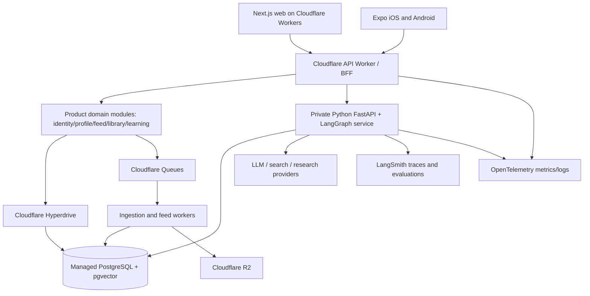

# 04 — System Architecture, Trust Boundaries and Scaling Path

## Architecture style
**Modular product backend + separately deployable agent backend, with asynchronous ingestion.** Avoid microservices prematurely. Keep frontend independent of LLM providers. APIs are owned by bounded contexts, not by individual screens.

**Placement:** Next.js App Router via Cloudflare Workers (spike vinext beta/OpenNext fallback). API Worker (Hono or minimal native Worker) handles auth/routing/product-domain reads and safe writes; Python FastAPI container handles LangGraph and RAG/tool-intensive AI; both reach managed Postgres via distinct tested connections. Cloudflare R2 for approved uploads/scene bundles, Queues for asynchronous workloads, scheduled triggers for opt-in discovery jobs. LangSmith for AI traces and evals; OpenTelemetry for whole-system correlations.

## Mandatory trust boundaries
Browser/mobile → gateway: OIDC/JWT/session validation, rate limits, request validation. Gateway → agent: private/protected origin and service identity; propagate user-scoped authenticated claims (never trust client-supplied user_id); Python revalidates entitlement and tenant for reads. Product/agent → DB: least-privileged users, segregated schemas or grants, parameterized statements, tenant filters; adversarial cross-user tests. Queues → consumers: signed payload/known schema, idempotency keys, retry budgets, DLQ.

## Ownership and responsibility
- Edge web: presentation, caching of public safe assets, authenticated SSR/BFF patterns; not source of truth.
- Product API: accounts/profile/topic prefs, recommendation serving, save/dismiss, library, learning and scenes metadata, consent state. No LLM per scroll.
- Agent API: retrieval/tools, memory-aware graph state, LLM service adapter, cancellation/budget; not source of truth for user profiles.
- Async workers: provider sync, enrichment, embeddings, candidate generation, feed refresh and data retention.
- DB: authoritative schema, relationships, transaction boundaries. PostgreSQL is the source of truth, not KV.

## Important data flows
**Feed read:** authorized `/v1/feed?cursor=...` → check profile/version → pull pre-ranked items or compute a cheap ranking from cached candidates → hydrate source metadata → exclude muted/dismissed/recently seen → signed next cursor → return response. No new provider API queries nor LLM inference in feed request path.

**Agent turn:** verified user + thread ID → load typed/checkpoint state → retrieve only authorized memory/source candidates → plan bound tool calls with budgets → validate source IDs/citations → stream progress/content with sequence and request ID → persist turn and provenance → trace redacted spans.

**Content ingest:** provider/manual ingestion request → transactional `ingest_jobs` + outbox event → queue publishing worker → consumer pulls source metadata/allowed content → canonicalize/dedupe → classify/tag/embed depending rights → update catalog/recommendation candidates → acknowledgement. Work must be idempotent.

## Failure behavior
Provider down: serve last valid catalog with stale badge; queue backlog alarm. Agent down: feed still works; research shows retryable status. DB degraded: cached non-sensitive public discovery only; no fake success of writes. LangSmith unavailable: do not fail user requests; buffer/drop traces per privacy policy. Worker retries: exactly-once **effects**, not exactly-once delivery, via DB constraints/idempotency.

## Scaling triggers and constraints
Early growth: scale independent Python workers by agent concurrency (not feed QPS); optimize DB connections and traces; instrument feed cache hit and p95 latency. Larger demand: replicas, dedicated vector indexing, asynchronous rerank worker, Redis if measurements prove need. Don't introduce Kafka, Neo4j, separate graph DB, multi-region active/active, or autonomous multi-agent mesh without ADR plus comparative benchmarks.

## Compatibility spikes (before irreversible decisions)
Verify vinext with auth, API streaming, SSR, deployed images and R2 binding; OpenNext fallback. Verify Expo real device network/secure storage, EAS compatibility. Verify auth provider cross-runtime JWT/JWKS. Verify provider data access, pricing and permitted persistence. Record measurements and choice in ADR.

## Link to source docs
- Cloudflare Next.js: https://developers.cloudflare.com/workers/framework-guides/web-apps/nextjs/
- Cloudflare Queues guarantees: https://developers.cloudflare.com/queues/reference/delivery-guarantees/
- Cloudflare Hyperdrive: https://developers.cloudflare.com/hyperdrive/get-started/
