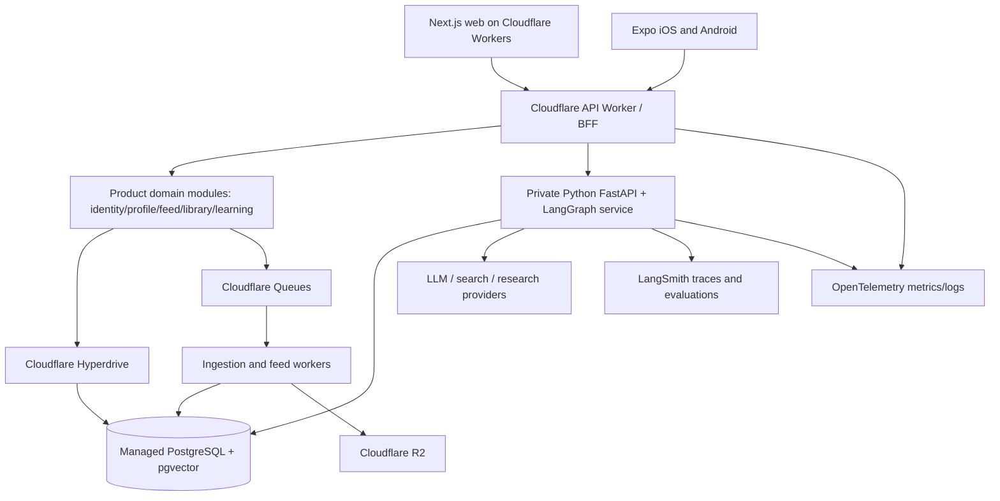

# 04 — System Architecture, Trust Boundaries and Scaling Path

## Architecture style

**Subject taxonomy rollout, 22 November:** keep the canonical v2 browse and
account subject order shared, but expand writable API/UI contracts only after
the additive PostgreSQL constraint migration passes on an isolated child and
the fixed shared-development target. Owner verification of 0004 now covers both;
data/private protections and the three-choice cap are preserved. Migration SQL
and applied checksums remain immutable. Legacy v1 readers fail closed on
unrepresentable choices instead of silently truncating preferences. A selectable
interest does not imply available reviewed content or changed ranking. Explicit
operator tooling reports only fixed CLI phases and truthful commit state; raw
connection-string output stays private. No startup/deploy DDL, new grants or
provider changes. Exact acceptance and the unproven transient CLI cause: docs/47.

**Appearance, 16 November 2026:** browser-local explicit light/dark preference
is applied by a small synchronous head script before body content/hydration;
system appearance remains CSS-driven when storage is unavailable or unset.
The shared storage key has no migration. Inline semantic canvas colors avoid
waiting for the main stylesheet. Only the html attribute mismatch is suppressed;
normal React hydration remains checked. No preference cookie, user-specific SSR
or server cache variation is required. Tests and rendered evidence: docs/24.

**Catalog activation, 16 November 2026:** initial import is an explicit operator
workflow, never startup, CI or deployment DDL. Rehearse on the accepted child,
then use the fixed existing development target. Check migration checksums,
restricted-role privileges and full private-data fingerprints; separately commit
hidden metadata/provenance/cover associations and reviewed publication. Review
decisions bind both resource and image bytes. Known conflicting metadata/reviews
abort rather than overwrite. Six held covers remain unpublished. Only WebP files
from accepted reviews enter the existing static pipeline; no new storage provider.

Legacy API **SQL must filter its four supported identities before LIMIT**. A
runtime four-row validator alone fails when v2 publication grows the same table.
Versioned public/private APIs and explicit web mode avoid that incompatibility.
Local/preview v2 activation requires matching actual development verification;
neither a successful build nor a staging checksum establishes a published catalog.
Rollback to v1 retains expanded saves/rows. Docs/45 and ADR register define the
operator sequence, limitations and outstanding live acceptance.

**Web-to-API transport, 16 November 2026:** deployed web Workers call the existing
API Worker through the `PRODUCT_API` HTTP service binding. The public API origin
remains the server-owned URL/identity boundary; it is not the network transport
for same-zone workers.dev calls. Preserve Fetcher's receiver, request deadlines,
response budgets and manual redirects. Reject another origin and fail closed
when a workers.dev binding is missing, malformed or unavailable; never retry via
the public URL. Local loopback HTTP remains available for normal development.
Catalog SSR/details and all account BFFs share this configuration. The binding
does not supply identity or bypass API origin, scope, session or RLS checks.
Preview source and generated artifact validation require exactly the existing
`polymatik-api-preview` target, without an environment/entrypoint override. API
still deploys before web. No database, provider, schema or secret changes.
See docs/42 and 24 for the observed preview failure and verification limits.
[Cloudflare HTTP service bindings](https://developers.cloudflare.com/workers/runtime-apis/bindings/service-bindings/http/)
and [same-zone routing restrictions](https://developers.cloudflare.com/workers/configuration/routing/custom-domains/).

**Private catalog compatibility, 15 November 2026:** Ticket 4b adds versioned
Library pages/individual mutation acknowledgements and seven-subject interests.
Keep v1 wire shapes and the default runtime configuration intact. Private cursor
positions retain PostgreSQL microseconds and use identical explicit byte ordering
in SQL and validation; they never grant account access. Each boundary verifies
the session and expected account, with transaction-local RLS through Hyperdrive.
A withdrawn resource keeps its user's saved identity with null public metadata;
removal must not depend on the resource still being public. Browser-to-account
copy is explicit and bounded, retaining originals and confirmed partial writes.
Legacy interests fail closed on expanded choices rather than truncate them.
Code rollback does not justify data rewrites. Deterministic and synthetic-browser
evidence does not replace live expanded SQL or hosted authentication acceptance.
No schema/provider/config changes in this slice. Details and tests: docs/45, 24.

**Public web catalog boundary, 14 November 2026:** Ticket 4a uses an explicit
server catalog version (default v1), not schema detection or a browser-selected
upstream. The v2 client renders authoritative five-entry pages, seven subjects
and canonical details. Same-origin public read handlers retain the 64 KiB budget
and never forward session credentials. Each device Library resolves its saved
IDs independently with two concurrent reads and explicit unresolved states;
aliases retain original removal IDs. Page changes cancel obsolete reads.
Only approved same-origin cover keys reach image elements; no staging bytes are
served. Existing account Library/interests contracts remain a separate Ticket 4b
compatibility gate before publication. Preview/Hyperdrive settings are unchanged.
Local fixtures establish client/runtime behavior, not live expanded SQL or hosted
delivery. Setup, tests and rollback: docs/45 and docs/24.

**Catalog API compatibility, 14 November 2026:** owner-run schema rehearsal now
passes on isolated br-muddy-bar-zayn69jl / ep-muddy-brook-za10nkn1 only. Parent
and private state are preserved; preview/production remain on their old schema.
Use new /v2/resources for the expanded public domain and bounded keyset pages;
retain strict /v1 response shapes while clients migrate. Seven subjects/six
kinds and approved-public cover/alias projections are separate from private
editorial evidence. Five-item pages and decoded 64 KiB limits bound memory.
Parameterized filters and every continuation recheck publication; cursors confer
no authority or cross-request snapshot. The owner's actual restricted-login
read-only API SQL probe passes on the accepted child; standard Wrangler API tests
pass 5/5 and packaging dry run passes. This verifies current-four direct SQL and
unconfigured-storage Worker behavior separately, not deployed Hyperdrive or new
published data. Preview configuration is unchanged. See docs/45.

**Authorized catalog rehearsal, 14 November 2026:** the explicit owner-run
`catalog-rehearsal.mjs --run` entry point binds the new non-default
`dev-catalog-expansion` data clone to its approved parent and direct compute
before migration 0003. Parent access is read-only; complete bounded private-row
fingerprints must match before/after. Separate owner and actual application
logins test schema constraints and tenant isolation, with probe fixtures rolled
back. Credentials stay in memory; existing environment/Hyperdrive configuration
is not repointed. Creation uses the plan's default compute settings, not a custom
suspend interval. Failure retains the branch and any committed ledger; never
reset a branch to repair acceptance. Agent CLI credential access failed with
EPERM, so live execution is still pending. Mock tests are not database evidence.
No import, cover upload, deployment or API change is included. See docs/45.

**Catalog schema preparation, 14 November 2026:** additive migration 0003 is
prepared, not applied. Keep current publication columns so old explicit-column
API queries remain compatible, but default new rows to hidden/draft. Approved
cover selection uses normal plus composite foreign keys with a generated public
approval requirement; cross-table approval must not be hidden in a CHECK lookup.
Historical four entries may keep their existing cover-free fallback. Editorial
evidence and art-review internals use private operator tables; the request role
reads only explicit approved-public art/alias projections. Interest taxonomy
widens while preserving the maximum three selections and existing RLS. An
ordered registry validates historical checksums and applies only the reviewed
next version in a transaction; legacy setup/startup never applies new versions
implicitly. No SQL was executed; isolated-branch migration, grants and real
two-user acceptance remain open. Design/rollback and references: docs/45.

**Catalog staging boundary, 14 November 2026:** imported research and cover
files are untrusted editorial inputs, not runtime seeds, publication approvals
or migrations. Ticket 1 uses a zero-write local validator/proposal with portable
real-path containment, checksums and strict reconciliation. It preserves the four
existing identities and proposes 56 hidden drafts; scores and provenance remain
editorial. Covers are all pending review. No database/network/environment access
is part of staging validation. Migration 0002 is already allocated to interests;
later catalog expansion needs a new version and must align private Library and
interest constraints with the expanded taxonomy. Existing auth/RLS/Hyperdrive and
public API behavior remain unchanged. Scope and limits: docs/45.

**Optional subject interests, 14 November 2026:** the next Profile slice stores
explicit account choices separately from saves and learning records. GET/PUT/
DELETE use the same managed-session/BFF/Hyperdrive trust boundary with dedicated
interests scopes and an expected-account precondition. Each SQL operation owns
one transaction and transaction-local subject; additive user_interests RLS joins
the existing private users policy. Database checks mirror the strict finite
taxonomy and selected/skipped states; absent rows mean not_started. No interest
is inferred from browsing, and choices do not change ranking/mastery. Migration
0002 and only its table grants were separately approved and applied by the owner
on 14 November. The real restricted-login save/edit/skip/reset, two-user read,
cross-user write denial and unsigned denial probe passes with fixture rollback.
No auto-migration or provider/Auth configuration change. Rendered and deployed
acceptance remain open: docs/44.

**Account Library implementation, 13 November 2026:** browser writes use the
same-origin BFF, which forwards only the opaque managed token. The product API
revalidates identity and library scope for every operation, and checks exact
mutation origin. An optional expected-account header is a precondition, never
identity: a changed session returns 409. One request-scoped pg client owns the
entire transaction, with set_config('polymatik.auth_subject', subject, true),
explicit subject predicates, and COMMIT/ROLLBACK. Never split these statements
across pool.query calls or retain session identity across requests. Profile
keeps private account saves distinct from browser-local originals. The existing
development role received the separately approved DELETE grant on saved_items
in the owner's terminal on 13 November; no automatic grant or managed Auth
schema change is part of runtime. The owner's real restricted-login probe passed
idempotence, own removal, two-user isolation, cross-user delete denial and unsigned
denial, with all fixture writes rolled back. UI and deployed Hyperdrive acceptance
remain open (docs/43).

**Client state lesson (10 November 2026):** the Neon client is a callable Proxy.
When storing it in React state after the browser-only import, use a value-returning
updater (`setClient(() => authClient)`). Passing it directly invokes an unintended
root auth request. A real SDK/React regression probe verifies zero requests during
storage. This client-loading check complements SSR and server handler tests.

**Managed Auth implementation lesson (9 November 2026):** Neon SDK server
handlers passed the vinext compatibility spike, but its browser SDK 0.8.2
generates a random tab ID at module evaluation. Importing it during Worker SSR
caused 500 responses despite a successful build. Load that browser client after
hydration, retaining the server-rendered Profile shell. Final built-Worker
Miniflare checks pass 13/13. SDK mock tests alone are insufficient evidence of
Worker compatibility or Google sign-in. The web now uses managed Auth; the owner
confirmed Google sign-in on 10 November. The API now independently validates the
opaque managed session token against the configured branch's get-session endpoint,
without cached browser claims. A configured workerd test with mocked Neon covers
two users and revocation; the live protected-API browser check remains open. Product SQL
continues through Hyperdrive; managed Auth owns its own auth schema.

**Modular product backend + separately deployable agent backend, with asynchronous ingestion.** Avoid microservices prematurely. Keep frontend independent of LLM providers. APIs are owned by bounded contexts, not by individual screens.

**Placement:** Next.js App Router via Cloudflare Workers (spike vinext beta/OpenNext fallback). API Worker (Hono or minimal native Worker) handles auth/routing/product-domain reads and safe writes; Python FastAPI container handles LangGraph and RAG/tool-intensive AI; both reach managed Postgres via distinct tested connections. Cloudflare R2 for approved uploads/scene bundles, Queues for asynchronous workloads, scheduled triggers for opt-in discovery jobs. LangSmith for AI traces and evals; OpenTelemetry for whole-system correlations.

## Mandatory trust boundaries
Browser/mobile → gateway: OIDC/JWT/session validation, rate limits, request validation. Gateway → agent: private/protected origin and service identity; propagate user-scoped authenticated claims (never trust client-supplied user_id); Python revalidates entitlement and tenant for reads. Product/agent → DB: least-privileged users, segregated schemas or grants, parameterized statements, tenant filters; adversarial cross-user tests. Queues → consumers: signed payload/known schema, idempotency keys, retry budgets, DLQ.

## Ownership and responsibility
- Edge web: presentation, caching of public safe assets, authenticated SSR/BFF patterns; not source of truth.
- Product API: accounts/profile/topic prefs, recommendation serving, save/dismiss, library, learning and scenes metadata, consent state. No LLM per scroll.
- Agent API: retrieval/tools, memory-aware graph state, LLM service adapter, cancellation/budget; not source of truth for user profiles.
- Async workers: provider sync, enrichment, embeddings, candidate generation, feed refresh and data retention.
- DB: authoritative schema, relationships, transaction boundaries. PostgreSQL is the source of truth, not KV.

## Important data flows
**Feed read:** authorized `/v1/feed?cursor=...` → check profile/version → pull pre-ranked items or compute a cheap ranking from cached candidates → hydrate source metadata → exclude muted/dismissed/recently seen → signed next cursor → return response. No new provider API queries nor LLM inference in feed request path.

**Agent turn:** verified user + thread ID → load typed/checkpoint state → retrieve only authorized memory/source candidates → plan bound tool calls with budgets → validate source IDs/citations → stream progress/content with sequence and request ID → persist turn and provenance → trace redacted spans.

**Content ingest:** provider/manual ingestion request → transactional `ingest_jobs` + outbox event → queue publishing worker → consumer pulls source metadata/allowed content → canonicalize/dedupe → classify/tag/embed depending rights → update catalog/recommendation candidates → acknowledgement. Work must be idempotent.

## Failure behavior
Provider down: serve last valid catalog with stale badge; queue backlog alarm. Agent down: feed still works; research shows retryable status. DB degraded: cached non-sensitive public discovery only; no fake success of writes. LangSmith unavailable: do not fail user requests; buffer/drop traces per privacy policy. Worker retries: exactly-once **effects**, not exactly-once delivery, via DB constraints/idempotency.

## Scaling triggers and constraints
Early growth: scale independent Python workers by agent concurrency (not feed QPS); optimize DB connections and traces; instrument feed cache hit and p95 latency. Larger demand: replicas, dedicated vector indexing, asynchronous rerank worker, Redis if measurements prove need. Don't introduce Kafka, Neo4j, separate graph DB, multi-region active/active, or autonomous multi-agent mesh without ADR plus comparative benchmarks.

## Compatibility spikes (before irreversible decisions)
Verify vinext with auth, API streaming, SSR, deployed images and R2 binding; OpenNext fallback. Verify Expo real device network/secure storage, EAS compatibility. Verify auth provider cross-runtime JWT/JWKS. Verify provider data access, pricing and permitted persistence. Record measurements and choice in ADR.

## Managed Auth development branching — verified provisioning recovery, 9 November 2026

The owner confirms this Neon project contains setup/test data only. Managed
Better Auth was already configured on production/neondb. A normal full child
branch, dev-auth-working (`br-noisy-poetry-zaka8dav`), created at
2026-11-09T09:41:40Z inherited managed Auth successfully: owner CLI status shows
better_auth, database neondb, and a distinct Auth/JWKS endpoint on
`ep-muddy-lab-za9hvwfl`. This is provider configuration evidence, not app login,
Google callback, session persistence or release acceptance.

Use normal branching from an Auth-configured source when the source data is
appropriate for development. Auth configuration is stored alongside Auth data;
schema-only copying is not an equivalent way to reproduce that environment.
The earlier schema-only rehearsal retained neon_auth structure but was
unconfigured; enabling against a separate database then returned HTTP 412.
The failing internal role/SQL operation remains unknown. A temporary CREATE
grant did not fix it and was revoked. No service-role privilege workaround is
part of the architecture. Preserve the failed branch for diagnosis.

Managed Auth owns authentication storage and its HTTPS service. Cloudflare
continues hosting the web/product API; product SQL uses Hyperdrive to Neon,
with pgvector remaining the semantic-index target. The current code still uses
self-hosted Better Auth. Replacing that boundary requires a verified Neon SDK
integration, explicit branch-bound session/token validation at the product API,
and logout/profile/failure-path tests. Do not run self-hosted migrations against
the managed neon_auth schema or assume provider status proves those tests.

Sources: [Auth branching](https://neon.com/docs/auth/branching-authentication),
[schema-only branches](https://neon.com/docs/guides/branching-schema-only).
Decision and evidence: docs/22 and docs/24; current setup: docs/39.

## Development SQL role separation — confirmed setup lesson, 10 November 2026

Migration 0001 is applied on dev-auth-working and its checksum matches. Owner
verification now explicitly reports ROLE_BYPASSES_RLS for neondb_owner. FORCE
RLS does not constrain a BYPASSRLS role. Using migration credentials for runtime
and isolation proof was a setup-script error, not evidence that the policy SQL
is broken. Preserve the migration and the owner's administrative privileges.

The prepared repair uses a SQL-created polymatik_app login with NOBYPASSRLS and
no elevated memberships. Migrations retain the owner connection; verification
and the local Hyperdrive launcher use the restricted login. The role gets only
CONNECT, product-schema USAGE, catalog SELECT and RLS-controlled SELECT/INSERT
on the two private foundation tables. No managed Auth grants or default
privileges are added. Neon Console/CLI-created roles inherit neon_superuser,
so they are not the role-creation path for this purpose. Role provisioning is
an explicit privileged setup step, separate from migrations and server startup.

The owner executed the reviewed repair on 11 November and confirmed actual
restricted-login verification, catalog 4/4 and the private-fixture RLS probe
passed, with the connection saved privately. This establishes the development
role repair. The owner then restarted the postgres-mode API and verified
GET /v1/resources returns all four reviewed resources; the curl request ID
matches its Worker log. This proves the local SQL-backed list path. Deployed
pooling/caching remain open. The owner also confirms local browser/detail,
save/reload and appearance integration works; broader rendered quality gates
remain separate. The agent's
independent DB/Worker checks are sandbox-blocked.
See docs/41 for exact grants, retry/secret handling and the command.

Sources: [Neon SQL-created roles](https://neon.com/docs/manage/roles),
[PostgreSQL RLS bypass](https://www.postgresql.org/docs/current/ddl-rowsecurity.html).

## Link to source docs

### Subject-aware discovery — 23 November 2026

M1-04a derives a deterministic selection from reviewed catalog metadata and
RLS-protected interests. Read-only POST /v2/feed and its same-origin BFF retain
managed verification, exact origins, account preconditions and no-store. At most
100 candidates and five results per page bound work; no per-scroll AI, new
service or migration. A per-session HMAC binds continuation to current account,
interests, filters, policy and catalog. It is freshness, never authorization;
every page rechecks identity. No credential or preference is encoded in cursors.
Account-keyed client state aborts on unmount; per-visit exclusions are explicit,
not cross-device history. Explore all remains complete. Persisted batches and
dismissals require a separate reviewed schema ticket. Policy/evaluation: docs/48;
actual evidence and delivery limits: docs/24.

- Cloudflare Next.js: https://developers.cloudflare.com/workers/framework-guides/web-apps/nextjs/
- Cloudflare Queues guarantees: https://developers.cloudflare.com/queues/reference/delivery-guarantees/
- Cloudflare Hyperdrive: https://developers.cloudflare.com/hyperdrive/get-started/
