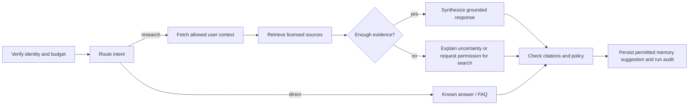

# 08 — LangGraph Orchestration, Tool Policies and LangSmith

## Architecture decision
Use **Python LangGraph open-source graph in FastAPI** with a PostgreSQL checkpointer; LangSmith observes, evaluates and compares experiments. No need to buy hosted Agent Server before validated need. One orchestrator with deterministic nodes and a small whitelisted tool set. 'Multi-agent' is not an MVP requirement.

## State model (TypedDict/Pydantic; versioned)
`tenant_user_id`, `thread_id`, `request_id`, `messages` (bounded), `intent`, `selected_resource_ids`, `working_query`, `retrieved_source_ids`, `retrieval_evidence`, `tool_budget`, `tools_used`, `draft_answer`, `citation_ids`, `risk_flags`, `run_status`, `last_user_action_at`. Never put full private bookmark collections or provider credentials in graph state. Keep user identity claims server-derived.

## Graph sketch

Start with simple `grounded_explain`; add comparison, learning-tutor and scene controller as separate graph versions only after tests. Bound iterations (e.g., <=3 tool steps initial), tool wall clock, model tokens and cost caps. Model provider adapter supports explicitly configured hosted model and deterministic fake for CI.

## Tool registry and least privilege
`retrieve_sources(query,domains,limit)`: searches rights-cleared corpus. `lookup_content_metadata(content_id)`: source metadata only. `get_user_interests()`: scoped; don't return sensitive data unrelated to request. `read_approved_memory(query)`: scoped and filtered. `search_external_resources(query,provider,budget)`: user-initiated or authorized background, quota/cost guard. `save_learning_note(...)`: write requires explicit user intent; not available to retrieval-only graph. `suggest_scene_actions(...)`: validated against curated scene capability manifest, no arbitrary code generation. All tools typed, timeout-bound, audited, permission-checked. Untrusted tool output is data only.

## Checkpoint vs long-term memory
LangGraph `AsyncPostgresSaver` stores per-thread graph checkpoints, supporting resumability; **NOT** durable personal intellectual profile by itself. Long-term preferences/mastery/bookmark signals live in typed product data and/or namespaced PostgresStore. Run `.setup()` as controlled schema init step, not ad hoc per request. Strict deserialization (`LANGGRAPH_STRICT_MSGPACK` / explicit allowlist) should be evaluated with your pinned SDK. Use async Postgres clients in container, pool and close appropriately.

## LangSmith instrumentation
Trace spans: `agent.run`, `route.intent`, `memory.retrieve`, `rag.hybrid`, `tool.call`, `model.generate`, `citations.verify`. Tags: app version, graph version, feature flag, domain, input source type, experiment ID. Record latency, token usage, tool errors, cost estimate, hallucination flags. Redact usernames, emails, private bookmarks, provider tokens and raw memory wherever possible; configure retention. LangSmith must never become a second uncontrolled private data lake.

## Offline eval strategy
Create annotated cases for known-source RAG, negative/no-evidence, contradictory sources, malicious prompt-injected post, wrong-user memory access, preference correction, topic divergence and tool overuse. Metrics: evidence retrieval Recall@k, citation support judged by passage, refusal when unavailable, tool correctness, step count/cost, first progress event latency, memory provenance accuracy. Compare experiments against pinned graph/model/retriever baselines; reject significant regressions even if responses feel better.

## Runtime contract
- Python service exposes typed streaming endpoint reachable only through gateway.
- `request_id` and trace correlation passed through Worker to FastAPI.
- User token/service auth verified twice; request cannot use arbitrary thread ID of another user.
- Deadline/cancellation propagated; orphaned tool calls and model usage stopped when possible.
- Failed tool calls show honest partial failure; never invent citation or claim tool succeeded.
- Provider response caching only where permitted and never across private tenant boundaries.

## Reference
https://docs.langchain.com/oss/python/langgraph/persistence
https://reference.langchain.com/python/langgraph.checkpoint.postgres/aio/AsyncPostgresSaver
https://docs.langchain.com/langsmith/evaluation-types
