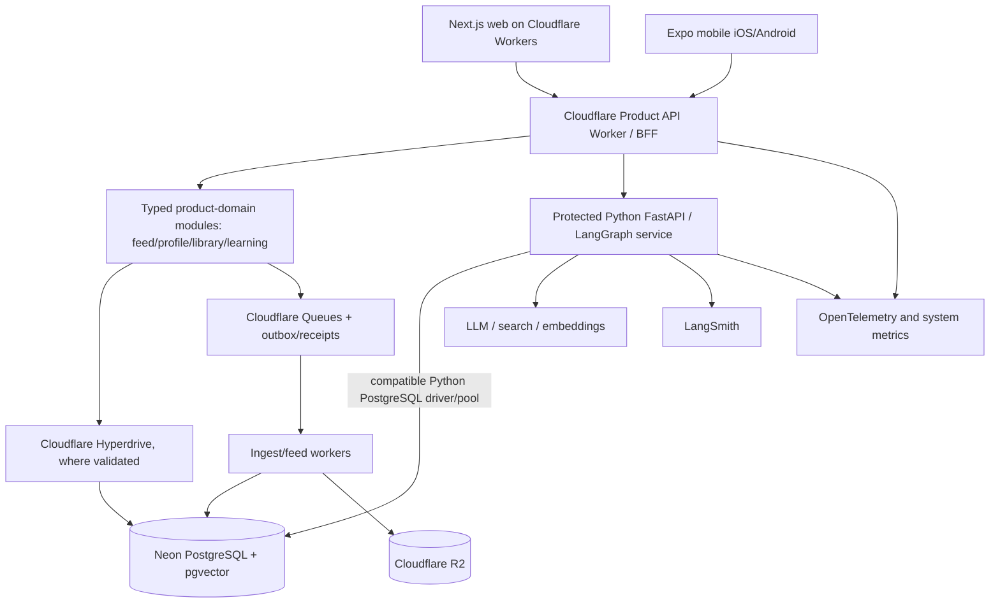

# 29 — Polymatik AI: v6 Architecture and Research Integration Addendum
## Cloudflare + Neon deployment specification; unresolved decisions; Agent Chronometry boundary

> **Read this first.** This document **adds to** the folder-based **v6** development handoff. It **does not replace, reissue or silently modify** `AGENTS.md`, `docs/00_SOURCE_OF_TRUTH.md`, `docs/01_PRODUCT_PRD.md`, `docs/04_ARCHITECTURE.md`, `docs/17_CLOUDFLARE_DEPLOYMENT_AND_DEVOPS.md`, `docs/20_IMPLEMENTATION_BACKLOG.md`, or accepted ADRs. Use **Polymatik AI** as the correct product name. Older documents that say “Polymatika AI” use a historical spelling.

**Intended location:** `docs/29_POLYMATIK_AI_V6_CLOUDFLARE_NEON_AND_SC_ADDENDUM.md` in the **v6 folder-based repository handoff**, not as a competing master blueprint. The consolidated v6 single-file copy is reference material; its source-folder files govern implementation.

**Owner direction established in discussion:** Prefer **Cloudflare for application delivery, edge services and object storage**, and **Neon PostgreSQL + pgvector as the authoritative relational and initial semantic-memory database**. Retain Python/FastAPI/LangGraph for core agent orchestration. Whether Cloudflare Containers, vinext, and particular DB connection modes pass deployment gates remains to be **tested**, not presumed.

**This is a decision supplement, not an instruction to deploy resources or spend money.** No account has been provisioned and no compatibility benchmark or live production smoke test has been conducted for this addendum.

---

## 1. Authority, merge policy and terminology

### 1.1 Precedence

1. **New explicit owner decisions**, including **product name = Polymatik AI** and **preferred stack = Cloudflare + Neon**, are authoritative in intent. Record their acceptance and technical scope in `docs/22_ADR_AND_DECISION_LOG.md` before irreversible implementation.
2. **v6 `AGENTS.md`, `docs/00_SOURCE_OF_TRUTH.md`, and v6 functional/security invariants** remain controlling implementation instructions.
3. **v6 architecture, APIs, tests, milestone order, and acceptance scenarios** remain controlling unless the owner explicitly changes them and an ADR records why.
4. **This addendum** elaborates still-provisional provider selections, compatibility tests, memory boundaries, costing, and SC research integration. It can **narrow** a v6 open option through a documented choice, but does not erase existing v6 requirements.
5. **v3.1/v3.2 and the previous `09_POLYMATIKA_CLOUDFLARE_NEON_DEPLOYMENT_SPEC`** are historical inputs, not parallel instruction sets. Do not execute their competing roadmap or repo tree.

### 1.2 Name correction — accepted owner decision

- Canonical display/product name: **Polymatik AI**.
- Historical labels `Polymatika`, `Polymatika AI`, including the v6 title, are **not** the current brand name.
- New user-visible copy, documentation titles, README introductions, application titles and new design work must use **Polymatik AI**.
- **Do not perform a blind search-and-replace** of code identifiers, URLs, domains, databases, imports, repository paths, old artifact filenames or credentials. Migration is deliberately scoped in an ADR because destructive renames can break apps and audit trails.
- Until renaming is explicitly approved, keep existing technical identifiers stable and describe them as legacy internal names. Branding and structural renaming are separate decisions.
- v6 references to “Polymatika” are **name-only historical inconsistencies**, not reasons to discard its product and security requirements.

### 1.3 Three decision statuses

| Status | Meaning | Current examples |
|---|---|---|
| **Owner-selected direction** | Strategic preference established; can inform implementation planning | Product name **Polymatik AI**; **Cloudflare + Neon** target; retain Python/LangGraph |
| **Recommended candidate / proposed ADR** | Preferred technical option, awaiting reproducible proof | **vinext first candidate**, OpenNext fallback; **Cloudflare Containers trial**; Hyperdrive where beneficial |
| **Open / do not assert** | Requires provider verification or real measurements | Cloudflare Containers vs alternative for interactive streaming; regions, concurrency, exact costs, production backup/restore, auth/adapter compatibility |

No proposal here is marked **“verified production-ready”** unless an executed test and an accepted ADR actually support that status.

---

## 2. Explicit non-conflict contract with v6

The following decisions are **already in v6** and are **retained unchanged**. This table exists to prevent the earlier generated architecture draft from accidentally reversing them.

| v6 requirement | Governing v6 location | This addendum's effect |
|---|---|---|
| **Discovery-first** product: feed → save/follow → grounded research → practice → continuity | `00`, `01`, `03`, `20` | **None**. Do not promote the Systems Explorer or research lab ahead of the feed MVP. |
| **Next.js web + Expo/React Native mobile** sharing product contracts | `00`, `03`, `04`, `05`, `20` | **None**. Mobile remains in initial architecture and M0/M1 verification. |
| **Dedicated Cloudflare TypeScript Product API Worker/BFF** plus separate **Python FastAPI agent service** | `04`, `05`, `07`, `08` | **None**. Do not collapse ordinary feed and profile ownership into FastAPI or a web-only route-handler layer. |
| **Cloudflare Queues with transactional outbox and idempotent receipts** | `04`, `07`, `17`, `20` | **None**. Do not use the older v3.2 suggestion to defer Queues as a reason to delete v6's asynchronous architecture. Validate complexity at v6 milestones. |
| **PostgreSQL + pgvector** primary canonical store; **R2** for permitted bytes | `04`, `06`, `10`, `17` | Resolves **Neon as preferred managed PostgreSQL vendor**, subject to validation. |
| **LangGraph checkpoints distinct from canonical user profile, memory and mastery** | `06`, `08`, `09` | Adds precise store/ownership and operational recommendations; does not collapse categories. |
| **LangSmith + traditional unit/integration/security/performance tests** | `08`, `18`, `25` | Adds targeted deployment/memory tests only. |
| **P0 narrow research, P1 Systems Explorer, optional/consented X connector** | `00`, `01`, `11`, `14`, `20` | **None**. No unauthorized provider ingest, clinical claims or production scene-code execution. |
| **One-ticket-at-a-time M0–M6 backlog**, starting **M0-01** | `20`, `21`, `24`, `28` | **None**. This addendum is not a replacement P0–P5 roadmap. |

**Repository topology remains the v6 layout:** `apps/web`, `apps/mobile`, `apps/api`, `services/agent`, `packages/*`, `infra/*`, `tests/*` and `docs/*`. Do **not** replace `apps/api` with an all-purpose Python backend or change the monorepo shape to match a past blueprint.

---

## 3. Target platform decisions: preferred architecture, not a redesign

### 3.1 Recommended deployment topology



- **Workers:** Next.js web delivery and a separately owned modular Product API; use Cloudflare edge protections and Workers bindings as appropriate.
- **Neon:** proposed managed hosting for **one PostgreSQL source of truth**; activate pgvector for licensed source retrieval and permitted semantic agent memories.
- **R2:** private, access-controlled approved documents, object bytes and reviewed educational assets. Relational metadata and authorization live in Neon.
- **Python/FastAPI/LangGraph:** separate deployable for model/tool orchestration, citations, typed graph state, memory read policies and SSE research runs.
- **LangSmith:** AI traces and evaluations; **not** backend correctness, system-wide uptime metrics or the authoritative research-event store.
- **Queues/Cron:** preserve v6 async import, recommendation refresh, deletion and opt-in scheduling, with explicit budgets, idempotency and dead-letter handling.
- **Cloudflare D1/Vectorize:** viable alternative architecture, but **not** selected for P0; avoid operating a second primary database and dual vector index without evidence.

### 3.2 Why this split is selected

- **Operational cost:** Workers and R2 can be inexpensive for lightweight, bursty application traffic; Neon avoids having to operate PostgreSQL on a self-managed VM.
- **Correctness and complexity:** canonical profiles, research provenance, access controls, learning attempts, and graph memory can share PostgreSQL transaction boundaries and established adapters, with separate logical ownership.
- **Workload separation:** relatively cheap feed/profile traffic need not wake the Python agent or incur model inference. Expensive agent concurrency scales independently.
- **Portability:** the Python Docker image and PostgreSQL SQL/application contracts survive a hosting-vendor move.
- **Research fit:** Python permits reproducible statistical and control/temporal experiments without moving production orchestration to a second implementation language.

**Do not treat Cloudflare + Neon as universally cheaper.** Compare the *total cost of the complete workload*: Workers, Container compute/memory/disk uptime, Neon CU-hours/storage/history/backup features, R2 operations, LLM/tool usage, LangSmith usage, queues, auth, and operational effort. Cost is measured **per meaningful learning session** and **per 1,000 agent turns**, not just by a database free-tier headline.

---

## 4. Next.js vs OpenNext vs vinext: deployment ADR supplement

They are **not three interchangeable frameworks**.

| Item | Role | Implication for Polymatik AI |
|---|---|---|
| **Next.js** | Application framework (App Router, React components, routes, RSC, SSR) | Maintain standard app structure and interfaces. |
| **OpenNext** | Adapter for real Next.js build output on Cloudflare Workers | Compatibility fallback, especially if vinext does not support required Next.js/auth features. |
| **vinext** | Vite-based reimplementation of much of the Next.js API surface | **First compatibility candidate** for a new Cloudflare Workers web app; currently beta, not identical behavior. |

**Recommendation, pending v6 ADR-002:** Test **vinext** first because it is the current Cloudflare-recommended path for new Workers Next.js projects; compare a minimal standard Next.js implementation with OpenNext fallback. Do not choose based on synthetic build-speed numbers alone.

**M0-02 acceptance extension (additive to v6):** capture exact pinned framework/tool versions and a deployed conformance matrix for: App Router navigation, SSR/RSC, route handlers, auth/OIDC session verification, Cloudflare bindings, React streaming, agent SSE passthrough/cancellation, image/static handling, relevant cache semantics, and mobile-to-API contract. If a needed feature fails, record a minimal reproduction and select OpenNext or another v6-approved route through ADR-002.

**No hidden migration:** a choice of vinext does **not** imply changing the Python agent to TypeScript; a choice of OpenNext does **not** imply abandoning Cloudflare Workers.

**Official references:**
- https://developers.cloudflare.com/workers/framework-guides/web-apps/nextjs/
- https://developers.cloudflare.com/workers/framework-guides/web-apps/opennext/

---

## 5. Cloudflare Containers + Docker: portable agent deployment candidate

### 5.1 What Docker compatibility means

Cloudflare Containers supports **Docker-compatible Linux container images** and deployment from Dockerfiles/image references. The initial container artifact should be a normal production Python image. Validate **`linux/amd64`** support, boot commands, health endpoints, environment/secrets, runtime dependencies and graceful shutdown.

- Docker is useful for **local development/building**, while Wrangler/Cloudflare coordinates production container image deployment and routing through Workers.
- Cloudflare Containers is **not** Docker Compose hosting: do not expect it to start Postgres, pgvector and the entire local stack inside one production Compose cluster. **Neon remains the managed database**.
- Containers can sleep/restart. Treat local filesystem as **ephemeral**; long-term memory, checkpoints, files and job state must live in Neon/R2/appropriate durable services.
- Native **stateless automatic autoscaling is not yet a general built-in guarantee** as of the cited 2026 documentation; avoid assuming concurrency scales without explicit routing/capacity configuration.
- Do **not** equate sleep/wake behavior with reliable background job execution. v6's Queues and persistent outbox remain authoritative.
- Docker image portability does not promise identical runtime behavior across hosts: networking, health, shutdown, resource and startup settings must each be verified.

### 5.2 Candidate hosting decision

**Trial Cloudflare Containers first**, because you already use Cloudflare and want to exploit low idle/operational cost. **Do not commit production interactive research traffic to it unless measured performance passes**. Keep a fallback to a standard Python-capable container platform running the **same image**, with configuration differences isolated.

**M0-05/M0-06 foundation plus later deployment spike:**

1. Produce a minimal Python/FastAPI Dockerfile and deterministic `/healthz` without LLM/API dependencies.
2. Build and run the image locally, including an AMD64-targeted build, with non-root user where feasible.
3. Run restart and state-recovery tests against Postgres; verify no essential state depends on container disk.
4. If **authorized**, deploy one staging container through Wrangler; test Worker → Container identity, streaming, cancellation, R2/Neon access and graceful shutdown.
5. Measure **cold/warm startup p50/p95**, first meaningful SSE progress, sustained concurrency, provider timeouts, container idle cycles, recovery and true billable resource usage.
6. Compare with the **same image** on an alternative host before recording a permanent ADR on container vendor.

**Failure rule:** if the deployment misses v6 SLOs, is too difficult to operate or has unfavorable cost under the realistic traffic mix, use the fallback host without rewriting the agent graph. Cloudflare Workers/R2/Neon may stay unchanged.

**Official references:**
- https://developers.cloudflare.com/containers/guides/deploy/
- https://developers.cloudflare.com/containers/faq/
- https://developers.cloudflare.com/containers/configuration/scaling-and-routing/
- https://developers.cloudflare.com/containers/platform/pricing/

---

## 6. Neon-specific deployment constraints and memory boundaries

### 6.1 Hosting vs abstraction

LangGraph's memory interfaces are **not a hosted database**. `InMemoryStore`/in-memory checkpoints are fine for small local experiments but not durable production memory. In production, keep these three categories separate even if they share one Neon instance:

| Domain | Data owner | Storage/operation | Do not confuse with |
|---|---|---|---|
| **Product authoritative state** | Product API / SQL migrations | User preferences and permissions, source provenance, learning outcomes, assessment records, consent, feed interactions | A model-generated memory sentence |
| **Agent operational state** | Python agent adapter | LangGraph PostgreSQL checkpointer for per-thread state and, as appropriate, `PostgresStore`/`AsyncPostgresStore` for namespaced agent memories | Canonical learner mastery or identity |
| **Retrieval index** | Corpus pipeline | PostgreSQL full-text search and **pgvector** for permitted source passages, embeddings, retrieval indexes | User-private, unpermissioned global RAG |

- Use LangGraph's supported Postgres adapters (`AsyncPostgresSaver` and a compatible Postgres Store if enabled) according to **pinned installed versions**. `.setup()`/DDL occurs in controlled initialization or migrations, **not on every request**.
- **Semantic memory is not automatic.** The store needs an embedding configuration or explicit embedding pipeline. Implement memory eligibility, user-confirmation/correction, provenance and TTL/deletion logic in the application/domain policies.
- Exact table names and schema placement for adapter-created persistence are **version-dependent**. Do not promise custom schemas or reimplement adapter tables casually.
- **Tenant isolation:** verify user identity at Product API and Python boundaries, namespace checkpoint/store by trusted user/thread and enforce user-filtered SQL for authoritative records. Test negative/cross-tenant cases.
- For a memory edit/deletion, remove or invalidate **all derived embeddings, checkpoints or dependent cached signals** as required by v6 retention/deletion policy.
- Keep **one canonical relational truth**. If the long-term Store contains a user fact derived from an app table, reconcile it as a cache/index representation with explicit provenance and revocation handling.

### 6.2 Cloudflare Workers → Neon connection: Hyperdrive

Cloudflare's documentation supports connecting Hyperdrive to **Neon PostgreSQL**. **Preferred candidate for `apps/api`** if it passes application-specific tests: a narrow least-privilege Neon database role through a Hyperdrive binding, using a compatible native Postgres driver (e.g. `pg`/Postgres.js).

- Hyperdrive is for **Workers' DB connections**; it does **not** replace or host Neon/PostgreSQL.
- Use **Cloudflare Hyperdrive** for Worker SQL where the driver supports it; verify the connection mode, role, rate limits, migration consistency and measured latency.
- Disable or tightly configure Hyperdrive **query caching for private, security-sensitive, freshly mutated or real-time data**; correctness supersedes micro-optimizations.
- Python FastAPI uses an independent **pool of compatible PostgreSQL connections** and follows LangGraph adapter driver requirements. Do not assume that the Workers Hyperdrive binding is your Python connection string.
- If the Product API owns ordinary product transactions, do not introduce a second independent Python owner of those mutations. For cross-component operations use versioned APIs/outbox/idempotent events.
- Staging/prod Neon branches or independent projects must keep environment isolation, separately scoped roles, tested migrations and recovery policies.

**Official references:**
- https://developers.cloudflare.com/hyperdrive/examples/connect-to-postgres/postgres-database-providers/neon/
- https://developers.cloudflare.com/workers/databases/third-party-integrations/neon/

### 6.3 Cost and region decisions to be proven

- Select Neon region by **measured Python agent → DB round trip**, Worker/Hyperdrive location and likely learner geography. Avoid picking the region solely because it is geographically nearest to one developer.
- Test read/write after scale-to-zero/wake, connection pool saturation, migration/rollback, backup/restore and failover behavior. Verify which backup/PITR features are included in the chosen paid/free plan before persistent production user state.
- Keep profile, RAG and agent state logically separated; use least-privilege DB roles, migration authority and idempotency keys. Graph checkpoints can be write-heavy; monitor their cost separately from app read paths.
- Start with **PostgreSQL FTS + pgvector**, not a dedicated vector database; only split search after task-level evidence demonstrates a measurable recall/latency/cost problem.

---

## 7. R2 and async work: v6-preserving implementation details

### 7.1 Cloudflare R2

- Authorize uploads through the Product API; use short-lived scoped upload grants or controlled signed URL flows where appropriate.
- Client-held R2 object keys and filenames are **not** authorization tokens. Verify ownership and permitted content rights in authoritative Neon metadata before access.
- Private storage by default for user-provided documents/bookmarks; never mix them into public recommendation or RAG datasets without explicit authorization.
- Store permitted source bytes, published reviewed scenes, exports and audit-safe derived artifacts; record checksums, provenance and deletion states.
- Run size/type limits and risk-appropriate upload validation. Ensure object lifecycle and deletion follow v6 privacy requirements.

### 7.2 Preserve Cloudflare Queues + transactional outbox

- v6 assumes **at-least-once** Cloudflare Queues semantics and **transactional outbox/receipts**. Retain this even if a prior chat-derived spec suggested delaying dedicated queue usage.
- Important job types include metadata ingestion, embedding update, feed recomputation, opt-in future discovery and account/memory deletion.
- Perform DB-state + outbox-event writes transactionally where possible; publish to Queues from a separate idempotent dispatcher; consumers must support retries, duplicate receipts and DLQ.
- An HTTP request or sleeping container is not reliable durable job storage. Use the v6 architecture and keep live requests fast.
- Actual queue creation and costs still require permission and acceptance tests under M0/M1/M2/M3/M4.

---

## 8. Testing: LangSmith does not replace backend or product tests

**Retain the entire v6 `docs/18_TEST_EVAL_STRATEGY.md` matrix and quality gates.** The following are **supplementary tests** for the provider/runtime decisions, not a new competing test framework.

| New targeted scenario | Required evidence | Existing v6 ticket/gate |
|---|---|---|
| vinext vs OpenNext on actual Workers | Auth, SSR/RSC, signed session, SSE streaming, dynamic routes, cache correctness, deployed E2E | **M0-02**, `ADR-002` |
| Web + Expo consume same Product API | Generated OpenAPI contracts, auth distinction, cross-platform acceptance, no Python-specific client assumptions | **M0-03/04** |
| Python Docker candidate deployment | Reproducible image, state independence, cold/warm latency, request cancellation, fallback benchmark | **M0-05**, staging integration, later host ADR |
| Worker→Neon connection | Privileged role separation, Hyperdrive behavior, permissioned reads/writes, caching disabled where needed | **M0-04/06**, `ADR-004` |
| PostgreSQL agent persistence | Checkpoint survives restart; semantic search accurate; memory provenance/correction/deletion; tenant isolation | **M2-03**, **M3-01** |
| Queue/outbox reliability | Duplicate delivery, partial commit, DLQ/retry, expired permissions, account purge under replay | **M0-06/M1/M3/M4/M6** |
| R2 file lifecycle | Authorized signed upload, permissions, metadata/version/hash, revocation/deletion | **M1/M2/M4/M6** |
| LangSmith + traditional testing | Correct software tests, redacted traces, labeled offline AI evaluations, no tracer critical-path dependency | **M0-05**, **M2**, **M6** |
| Agent Chronometry experimental readiness | Observer overhead control, frozen task/model/corpus, separate consent/evidence storage | **Research-only**, not P0 release gate |

### 8.1 CI additions, not replacements

Run TypeScript/Python static checks, deterministic unit tests, DB migrations against disposable Postgres, multi-user isolation, contract validation, limited LangSmith eval suites for agent-affecting changes, Worker build/deployment tests, Expo smoke, queue fault injection and restore drills according to **v6**.

**Hard-fail invariants:** cross-user memory/bookmark disclosure, forged citations, unauthorized tool use, key leakage, broken consent/purge, unreviewed executable scene code or false claims of completed tests. Keep run IDs, PR links, deployed URLs, artifacts and failure logs in `docs/24_IMPLEMENTATION_LOG.md`.

---

## 9. Systemic Chronometry and Agent Chronometry: explicit but optional research integration

### 9.1 Relationship and boundaries

- **Systemic Chronometry (SC):** overarching interdisciplinary research framework concerning temporal organization and cross-scale coordination of nested adaptive systems.
- **Agent Chronometry:** the SC research program investigating how harness ordering, scheduling, feedback delay, verification cadence, memory horizon and temporal policy affect agent trajectories and outcomes.
- **Polymatik AI:** an SC-inspired product for discovery, interdisciplinary inquiry, memory-supported research and independently assessable learning. It **may provide a reproducible experimental substrate**; it is **not** itself proof of SC.

The product and research share concepts and sometimes code, **not unrestricted access to learner data**. A user who opts in to learning analytics has not automatically consented to scientific research reuse; establish separate lawful consent or other valid basis and retention/withdrawal rules before any research experiment involving user data.

### 9.2 Reflexive Research Principle — methodological proposal

> In an adaptive-system study, measure not only the target system's behavior, but also the observer, evaluation, model-revision and control processes whenever they can affect the behavior measured or the inferences drawn.

**Intellectual lineage:** second-order cybernetics, learning-to-learn, double-loop learning, control/decision theory and scientific measurement methodology. **Status:** proposed SC research discipline, *not* a new empirical physical law.

**Separate three loops:**

1. **Learning loop (product):** discover → investigate → attempt/explain/predict → verified feedback → authorized learner-state update → future discovery.
2. **Agent-improvement loop (engineering):** instrument graph/tool use → evaluate on labeled datasets → correct failures and policies → regression testing.
3. **Research loop (SC):** preregister a claim → control temporal variable → independently measure trajectories/outcomes → falsify/replicate → revise claims.

An application event log, LangSmith trace and experiment event log are **related but distinct objects**. A model self-explanation is not a transparent observation of its internal computation.

### 9.3 SC epistemic registers — enforce in knowledge/research layers

| Register | Permissible output | What cannot be inferred |
|---|---|---|
| **L1 empirical/engineering** | Testable mathematical mechanisms, explicit datasets, measured effects, reproducible experimental bounds | That one workload proves universal temporal laws |
| **L2 structural/isomorphism** | Typed cross-domain analogies, mapped assumptions, known mismatches, counterexamples | That structural similarity implies identical causal mechanism |
| **L3 philosophical/speculative** | Exploratory philosophical ideas, symbolic/interpretive hypotheses labeled as such | That metaphor, intuition or aesthetic coherence is verified scientific evidence |

The v6 `concept_edges` and cited provenance rules are appropriate starting points. Add optional fields/relations only under the v6 schema/ADR process; no graph-database requirement is introduced.

### 9.4 Existing Agent Chronometry experiment IDs — do not renumber

Retain the separate **`SC_Agent_Chronometry_Research_Program_v0.2_2026-10-17.md`** as an external research reference (historical product spelling in its filename):

| ID | Research topic | Relationship to Polymatik AI |
|---|---|---|
| `AC-EXP-001` | Observer/instrumentation validation | Required *research* foundation, not MVP product scope |
| `AC-EXP-002` | Verification-cadence intervention | Controlled harness experiments |
| `AC-EXP-003` to `AC-EXP-006` | Ordering, feedback delay, memory horizon, multi-agent coordination | Later research agenda |
| `AC-EXP-007` | Adaptive memory-retrieval timing | Optional benchmark using anonymized/synthetic Polymatik-like tasks |
| `AC-EXP-008` | Reflexive evaluation-policy revision | Future research question; independent evaluator governance |

**Research guardrails:** keep experiments separate from production request routing until a documented, consent-appropriate plan exists. Preregister hypotheses and primary outcomes, freeze task/model/prompt/retrieval corpus as much as possible, repeat trials, include negative controls, log observer overhead and perform independent review. Null findings constrain SC rather than being explained away.

### 9.5 SC collaboration does not create MVP blockers

The product's initial success metric stays **meaningful discovery and demonstrable learning**, as defined in v6. SC experiments are an optional parallel laboratory; do not divert M0/M1 engineering into a general multi-agent research platform. A product’s market success, greater retrieval quality or a plausible analogy is **not** empirical confirmation of SC.

---

## 10. ADR integration instructions — no silent status upgrades

This table recommends what to **propose or append** within v6 `docs/22_ADR_AND_DECISION_LOG.md` after relevant tests. It is **not** evidence that those ADRs are already accepted.

| Existing or proposed ADR | Owner preference / recommendation to record | Still needs proof before production |
|---|---|---|
| **ADR-002** | vinext **first candidate** for Cloudflare-hosted Next.js; OpenNext fallback | Deployed compatibility matrix, OIDC, streaming/cancel, caching, app features |
| **ADR-003** | Retain separate TypeScript Product API Worker and Python FastAPI/LangGraph agent | Verified protected cross-boundary identity, generated contracts, latency and backpressure |
| **ADR-004** | **Owner-selected Neon** provider for PostgreSQL + pgvector, using Cloudflare delivery/R2 | Pricing/regional fit, drivers, role permissions, backups/restore, vector performance |
| **ADR-006** | Separate app SQL migrations from LangGraph-owned checkpoint/store setup | Test repeatability and recovery; no per-request DDL |
| **ADR-007** | LangSmith for AI evaluations, conventional tests still mandatory | Redaction and offline/online eval baselines |
| **ADR-008** | **Keep** Cloudflare Queues + transactional outbox and receipts | Delivery/replay, DLQ, duplicate-effects prevention |
| **ADR-013 (suggested)** | Canonical public name = **Polymatik AI**, legacy internal names held stable until scoped migration | Audit brand strings, URLs/envs/imports and approve safe rename plan |
| **ADR-014 (suggested)** | Cloudflare Containers **evaluation candidate** for portable Dockerized Python service | Cold/warm streaming, concurrency, reliability, restarts, unit cost, fallback proof |
| **ADR-015 (suggested)** | Hyperdrive for Worker→Neon connections when validated; direct compatible Python pool | Query cache consistency, connection churn, cost and least-privilege roles |
| **ADR-016 (suggested)** | Product–SC boundary: optional, consent-governed research; no automatic product trace reuse | Ethics/privacy assessment, isolated data, experimental preregistration |

**Proposed owner approval wording for the ADR ledger:**

> The product is named **Polymatik AI**. Its v6 specification remains the normative source for discovery-first product requirements, web + Expo clients, Cloudflare Product API ownership, FastAPI/LangGraph research service, Cloudflare Queues, test/quality gates and M0–M6 ticket order. The preferred hosted database is **Neon PostgreSQL + pgvector**; the preferred application and file platform is **Cloudflare Workers + R2**. Cloudflare Containers and vinext are candidates pending compatibility/performance proof; OpenNext and a portable non-Cloudflare container host remain fallbacks. These are architectural decisions, not statements that staging deployments or benchmarks have succeeded.

---

## 11. Mapping addendum to existing v6 implementation milestones

**No new parallel roadmap is authorized.** Fold only the relevant tests/decisions into these existing tickets **as they become active**:

| v6 ticket | Additional work from this note | Not allowed |
|---|---|---|
| **M0-01** | Read addendum; preserve `apps/api`, `apps/mobile`, `services/agent`; capture nomenclature and add ADR placeholders; keep offline scaffolding | Creating paid Cloudflare/Neon resources; building an AI research platform |
| **M0-02** | Execute vinext vs OpenNext compatibility proof and update ADR-002 | Declaring beta adapter safe without deployment tests |
| **M0-03** | Validate Expo app and shared contracts | Deferring Expo simply because earlier v3 plans were web-only |
| **M0-04** | Worker Product API proof, Hyperdrive connection *spike* only when a non-production DB is authorized | Moving canonical product API into Python |
| **M0-05** | FastAPI + LangGraph fake-model tests; portable Docker build, optionally staging Container spike | Treating cold/warm Containers trial as production approval |
| **M0-06** | Local pgvector migrations, two-user isolation; record Neon vendor requirements as ADR-004 | Production migrations or credentials without permission |
| **M1** | Discovery feed remains first; add source/cost monitoring | Replacing feed MVP with interactive 3D lab |
| **M2–M3** | Checkpoints, RAG, consented memory correction/deletion, LangSmith quality gates | Unapproved user profiling, assuming embeddings alone prove learning |
| **M4** | Authorized connector consent/revocation, queue deletion, verified terms | Implicitly scraping X or ingesting private bookmarks globally |
| **M5** | Curated, reviewed Systems Explorer from v6 | User-triggered arbitrary executable scenes |
| **M6** | Staging/performance/restore/cost benchmarks, container host sign-off, research isolation review if opted-in | Declaring reliability/economics based on provider marketing |

### Suggested repository insertion

Create **only** the following new documentation file for this update:

```text
polymatik/                 # illustrative human-facing project label; do not rename an existing repo automatically
└── docs/
    └── 29_POLYMATIK_AI_V6_CLOUDFLARE_NEON_AND_SC_ADDENDUM.md
```

To guarantee coding agents actually read it, **optionally** add this single pointer to `AGENTS.md` or `docs/00_SOURCE_OF_TRUTH.md` after the owner approves the documentation change:

> Also read `docs/29_POLYMATIK_AI_V6_CLOUDFLARE_NEON_AND_SC_ADDENDUM.md` for owner-selected product naming, Cloudflare + Neon provider direction, provisional runtime evaluations and the optional SC research boundary. Where it conflicts with functional/security/backlog requirements, v6 controls; resolve explicit owner-level changes in `docs/22_ADR_AND_DECISION_LOG.md`.

**Do not edit the original v6 content automatically as part of reading this file.** The pointer/ADR changes should be deliberate small documentation commits.

---

## 12. Verification and done criteria for this addendum

This documentation addendum is integrated into the handoff when:

- [ ] New output and agent prompts use **Polymatik AI** (not the former public spelling).
- [ ] The addendum is located at its intended `docs/29_...md` path and is linked by `AGENTS.md`/source-of-truth instructions, or explicitly named in the current coding-agent prompt.
- [ ] `docs/22_ADR_AND_DECISION_LOG.md` records the owner preference for Neon and the open adapter/container choices, without claiming tests ran.
- [ ] v6 remains the only normative backlog and continues from the first uncompleted ticket.
- [ ] `apps/mobile` and `apps/api` have **not** been dropped; the discovery-first MVP and Queues/outbox design remain intact.
- [ ] No paid Cloudflare/Neon deployment has been performed without explicit authorization.
- [ ] Provider-dependent capabilities are revalidated against current official docs and measured workloads before marking an ADR accepted for deployment.
- [ ] SC research data is not silently extracted from production learning activity; research consent/governance remains separate.

### Immediate coding-agent handoff (copy/paste)

> Use the folder-based **Polymatik AI v6** handoff as authoritative. Read `AGENTS.md`, `docs/00_SOURCE_OF_TRUTH.md`, `docs/04_ARCHITECTURE.md`, `docs/20_IMPLEMENTATION_BACKLOG.md`, `docs/22_ADR_AND_DECISION_LOG.md`, `docs/24_IMPLEMENTATION_LOG.md`, and `docs/29_POLYMATIK_AI_V6_CLOUDFLARE_NEON_AND_SC_ADDENDUM.md`. Apply this addendum **only to owner-approved naming, provider selections, still-open ADR evaluations and research boundaries**. Preserve v6's discovery-first web + Expo scope, Product API Worker, Cloudflare Queues and M0–M6 milestone order. Start or continue with the first incomplete ticket whose dependencies are actually verified; never invent test results, silently change the architecture, create paid resources, or perform an unapproved rename.

---

## 13. Reference registry and provenance

### Primary project specifications (provided by owner / prior conversation)

- **Canonical:** `POLYMATIKA_AI_MASTER_CONTEXT_V6(1).md` — consolidated copy of the folder-based v6 handoff, 20 October 2026. The old filename is historical and is not an instruction to use the former product name.
- **Historical architecture draft, selectively reconciled:** `09_POLYMATIKA_CLOUDFLARE_NEON_DEPLOYMENT_SPEC_2026-10-20.md` — source of candidates, trade-offs and Docker/Neon details; **not** a replacement for v6.
- **Historical v3.2 blueprint:** `Polymatika_AI_Master_v3.2_2026-10-20.md` — background vision and SC product relationship; implementation parts superseded when inconsistent with v6.
- **SC research reference:** `SC_Agent_Chronometry_Research_Program_v0.2_2026-10-17.md` — experiment numbering, reflexive method and L1/L2/L3 boundaries. Not automatically part of the production backlog.

### Official platform references (checked 20 October 2026; reconfirm before implementation)

- Cloudflare vinext Next.js: https://developers.cloudflare.com/workers/framework-guides/web-apps/nextjs/
- Cloudflare OpenNext: https://developers.cloudflare.com/workers/framework-guides/web-apps/opennext/
- Cloudflare Containers deployment: https://developers.cloudflare.com/containers/guides/deploy/
- Cloudflare Containers scaling/routing: https://developers.cloudflare.com/containers/configuration/scaling-and-routing/
- Cloudflare Containers FAQs: https://developers.cloudflare.com/containers/faq/
- Cloudflare Neon/Hyperdrive: https://developers.cloudflare.com/hyperdrive/examples/connect-to-postgres/postgres-database-providers/neon/
- Cloudflare R2: https://developers.cloudflare.com/r2/
- LangGraph persistence: https://docs.langchain.com/oss/python/langgraph/persistence
- LangSmith evaluation: https://docs.langchain.com/langsmith/evaluation-types

**Epistemic note:** platform capabilities cited above are vendor documentation, not proof of compatibility with Polymatik AI's exact dependency versions, load patterns or budgets. The addendum makes **recommended choices and acceptance tests**, not claims of successful deployments, experiments or measured savings.
